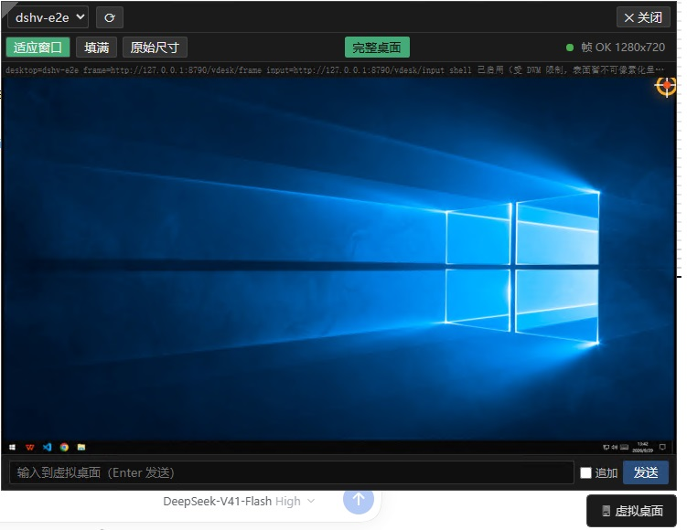
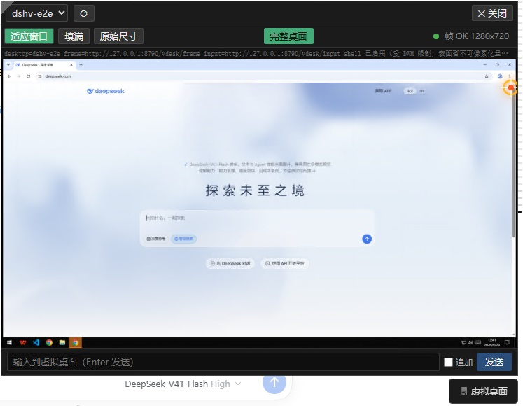
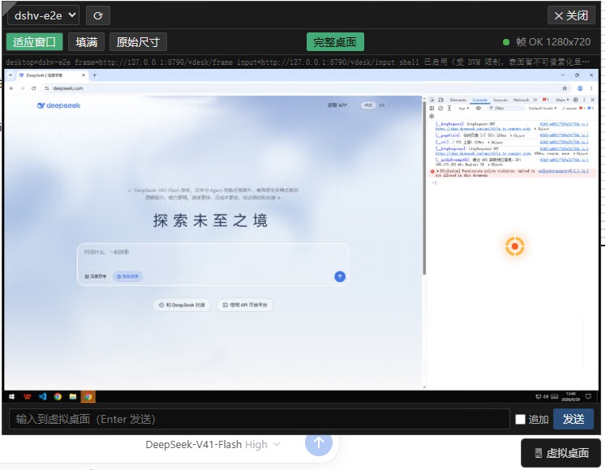
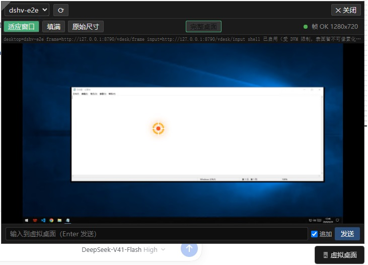

# dsh-vdesktop

**dsh-vdesktop** 是 [DSH（DeepSeek Harness）](https://github.com/) 的一个 cordis 插件：它在你本机上开一个**用户看不见的 Win32 虚拟桌面**（`CreateDesktopW`），把 GUI 应用跑进这个隔离桌面里，然后——

- **给模型**：提供 12 个 `vdesk_*` 工具，让 Agent 对虚拟桌面上的应用截图、点击、打字、读文本、存文件；
- **给人**：DSH 的 Web GUI 里提供一个 **VDesktopPanel** 面板，实时看到虚拟桌面的画面，并直接用鼠标点击操作（标准窗口的标题栏 ×/最小化/最大化、任务栏按钮都是真的）。

面板截图（本机 Windows 10 1809 LTSC 实测，均为 DSH Web GUI 中的 VDesktopPanel）：

| VDesktopPanel 面板 |  |
| --- | --- |
| <br>面板总览：桌面切换、实时帧（1280×720）、底部「输入到虚拟桌面」直发通道 | <br>虚拟桌面里正在运行的浏览器（DeepSeek 官网），右上角橙色为叠加光标 |
| <br>画面细节可放大看清：桌面内浏览器的 DevTools 控制台 | <br>点任务栏打开的资源管理器窗口，光标叠加在客户区 |

## 特性

- **虚拟桌面生命周期**：创建 / 附着 / 列表 / 关闭 / 孤儿清理（`dshv-` 前缀的桌面在 DSH 启动时自动 sweep）。
- **Agent 工具面（12 个 `vdesk_*` 工具）**：桌面生命周期、整桌截图、区域放大（1x–4x zoom）、鼠标（move/click/double/right/middle/drag/scroll）、键盘（type/press/hotkey，含中文与 emoji）、写文本、读文本、把窗口文本存成文件。
- **帧数据面**：插件内置一个 `frameServer`（HTTP，`127.0.0.1:8790` 起自动探测到 8799），Web 面板通过它低频轮询 PNG 帧；光标位置经响应头（`X-Cursor-X/Y`）随帧下发，由面板叠加绘制。
- **真实窗口语义的点击**（面板/Agent 共用同一执行面）：
  - 标准 DWM 标题栏的 ×/最小化/最大化 → `WM_NCHITTEST` 判别后直接发 `WM_CLOSE` / `SC_MINIMIZE` / `SC_MAXIMIZE|RESTORE`（对记事本、资源管理器这类标准框直接生效）；
  - 自绘标题栏的窗口（VSCode、WPS 等）→ `postmessage` 客户区消息，走应用自己的处理逻辑；
  - 任务栏按钮点击 → 等价窗口管理动作（激活 / 启动该按钮对应的应用）。
- **进程监督**：Python sidecar 以子进程方式由插件托管，心跳监测 + 惰性重启 + 空闲回收。

## 架构

```
┌─────────────────────────────── DSH (cordis) 应用进程 ───────────────────────────────┐
│  插件 dsh-vdesktop (lib/index.js)                                                    │
│  ├─ SidecarSupervisor ──JSON-RPC over stdio──▶ python -m dshv  (sidecar 子进程)     │
│  ├─ FrameServer (127.0.0.1:8790+) ◀──HTTP 抓帧/输入── DSH Web GUI (VDesktopPanel)   │
│  └─ 12 个 vdesk_* 工具 + computerUse 注入（供 Agent 使用）                           │
└──────────────────────────────────────────────────────────────────────────────────────┘
                                                              │
                                    python dshv (纯 ctypes，无第三方依赖)
                                                              │ CreateDesktopW / BitBlt / PostMessage
                                          ┌───────────────────▼───────────────────┐
                                          │  虚拟桌面 dshv-*（用户屏幕上看不到）    │
                                          │  notepad / explorer / 任意 GUI 应用    │
                                          └───────────────────────────────────────┘
```

- **sidecar**（`sidecar/dshv/`）：纯 Python ctypes 实现，虚拟桌面生命周期、GDI 抓帧、缩放、编码，以及输入链路（`SendInput` → `PostMessage` → `SendMessage` 逐级降级 + 光标自维护）。
- **frameServer**（`src/frameServer.ts`）：轻量 HTTP 服务，`/vdesk/frame`、`/vdesk/desktops`、`/vdesk/input`、`/vdesk/launch`、`/vdesk/processes`、`/vdesk/activate`、`/vdesk/close_window` 等路由，转发给 sidecar。

## 环境要求

| 组件 | 要求 |
| --- | --- |
| 操作系统 | Windows 10 / 11（1809 LTSC 实测） |
| 运行时 | Node.js LTS（构建与插件宿主） |
| Python | 3.11+（sidecar 纯 ctypes，**无需 pip 安装任何依赖**） |
| 宿主 | DSH（含 cordis 插件机制） |

## 安装

此 fork 的安装包已包含宿主、可拖动浮钮和 Python sidecar。Windows 需要可执行的 `python`（3.11 或更新版本）。

在已安装 DSH 命令行的 PowerShell 中，将插件加入桌面配置：

```powershell
dsh plugin --profile desktop add dsh-vdesktop@0.2.1
```

也可以将命令中的 `dsh-vdesktop@0.2.1` 换成 [GitHub 安装包](https://github.com/DescartHsu/dsh-vdesktop/releases/download/v0.2.1/dsh-vdesktop-0.2.1.tgz)的下载地址。

安装命令会自动启用插件，安装完成后重新打开 DSH。使用 Web profile 时将命令中的 `desktop` 换成 `web`。插件会自行定位随包安装的 sidecar。本地 Web 界面默认支持 `http://127.0.0.1:3080`，使用其他本地 Web 地址时可在插件配置中设置 `webOrigin`。

右下角的“虚拟桌面”按钮可以直接拖到窗口内其他位置，松手后会记住位置。单击按钮打开或收起面板。

## 使用

### 面板（VDesktopPanel）

- 选择 / 创建虚拟桌面，画面以低频轮询方式实时刷新；
- 画面上的**点击就是真实输入**：点标题栏 ×/最小化/最大化直接生效（标准窗口走 `WM_NCHITTEST` 非客户区拦截，自绘窗口走 `postmessage`）；点任务栏按钮等价于激活 / 启动对应应用；
- 面板上的光标是叠加层（经 `X-Cursor-X/Y` 响应头跟随），不是烧进帧里的。

### Agent 工具（`vdesk_*`）

| 工具 | 用途 |
| --- | --- |
| `vdesk_desktop_create` | 创建虚拟桌面并启动一个 GUI 应用（返回桌面句柄 / PID / 顶层 HWND） |
| `vdesk_desktop_close` | 关闭虚拟桌面并终止其上的进程 |
| `vdesk_desktop_list` | 列出所有 `dshv-*` 虚拟桌面 |
| `vdesk_orphan_sweep` | 清理孤儿虚拟桌面 |
| `vdesk_screenshot` | 整桌截图落盘（jpg/png，可选质量） |
| `vdesk_zoom` | 指定区域 1x–4x 放大截图 |
| `vdesk_click` | 单点（left/right，客户区坐标） |
| `vdesk_mouse` | move / click / double_click / right_click / middle_click / drag / scroll |
| `vdesk_keyboard` | type / press / hotkey（支持中文、emoji 与组合键） |
| `vdesk_type` | 向目标窗口写入整段文本 |
| `vdesk_read_text` | 读取目标窗口文本（优先 Edit 子窗） |
| `vdesk_save_file` | 把窗口文本保存到文件 |

## 行为细节与已知限制

- **输入降级链**：sidecar 的 vdesk 工作线程里 `SendInput` 恒 `ACCESS_DENIED`（虚拟桌面非前台），因此客户区点击实际走 `postmessage`（客户区坐标）；标准框标题栏按钮由 `WM_NCHITTEST` 判别后直接发窗口管理消息，两条路径都已在验收矩阵覆盖。
- **launch 是异步的**：`/vdesk/launch` 立即返回 `pid`（`windowReady` 恒为 `false`），目标窗口稍后才出现，请**按 pid 匹配**顶层窗口。
- **开始菜单**为最佳努力：任务栏"开始"按钮触发 `taskbar/start` 动作，完整开始菜单操作需要真实输入通道，暂未实现。
- **光标**由 sidecar 自维护"最后已知位置"并在每帧点击后同步（任务栏 / 标题栏按钮 / 客户区三条路径都会跟随）。
- **端口**：frameServer 从 8790 起探测，冲突时 +1 直到 8799 上限；CORS 精确白名单默认 `http://127.0.0.1:3080`（DSH Web GUI）。
- **DPI**：在 100% 缩放的 1920×1080 桌面实测（帧 1280×720 ← 源 1920×1080 线性映射）；其他缩放比未系统验证。

## 开发

```powershell
npm run build                # TS 侧 esbuild → lib/
cd sidecar
python -m py_compile dshv\rpc_stdio.py   # sidecar 语法自检
python -m dshv --help        # CLI：--create-desktop / --attach-desktop / --sweep / --rpc stdio
```

- 设计文档（`gui-agent-plan` 01–07b）、里程碑交接记录保留在作者本地工作区，未随仓库发布（仓库只含运行所需代码）；
- 一次性补丁/验收脚本（`scripts/patch-*.mjs`、`scripts/accept-*.mjs` 等）保留在作者本地工作区，未随仓库发布；
- 抓帧为纯 GDI（`BitBlt` + 缩放 + JPEG/PNG 编码），不依赖 GDI+ 或任何第三方 Python 包。

## 仓库结构

```
├── src/                  # TS 插件主体（supervisor / frameServer / 工具 / Web 面板）
│   ├── client/           # VDesktopPanel Web UI
│   ├── tools/            # 12 个 vdesk_* 工具定义
│   └── transport/        # JSON-RPC over stdio
├── lib/                  # esbuild 构建产物（link: 安装免构建即用）
├── sidecar/
│   ├── pyproject.toml    # dshv 包定义（Python 3.11+，纯 ctypes）
│   └── dshv/             # sidecar 产品包（win32 抓帧/输入/桌面生命周期）
├── scripts/build-ts.mjs  # npm run build（tsc + esbuild → lib/）
├── screenshots/          # README 引用的面板截图
├── cordis.patch.yml      # cordis 服务声明（安装时按本机路径修改 sidecarCwd）
├── package.json          # 插件包 dsh-vdesktop
└── esbuild.config.mjs / tsconfig.json
```

## License

[MIT](LICENSE) © dsh-vdesktop contributors

基于 [DSH / cordis](https://github.com/) 插件机制构建。

---

## English Overview

`dsh-vdesktop` is a plugin for **DSH (DeepSeek Harness / cordis)** that runs GUI applications on an isolated, invisible **Win32 virtual desktop** (`CreateDesktopW`). An LLM agent drives those apps through 12 `vdesk_*` tools (screenshots, zoom, mouse, keyboard, text I/O, desktop lifecycle), while the DSH web GUI ships a **VDesktopPanel** so a human can watch the virtual desktop live and operate it with real mouse clicks — title-bar buttons, taskbar buttons and window management all behave like a normal desktop.

Stack: TypeScript plugin (`src/`, built to `lib/`) + a dependency-free pure-ctypes Python sidecar (`sidecar/dshv/`, JSON-RPC over stdio) + a built-in frame server (`127.0.0.1:8790+`). Windows 10/11, Node LTS, Python 3.11+. See the Chinese section above for installation and usage details.
